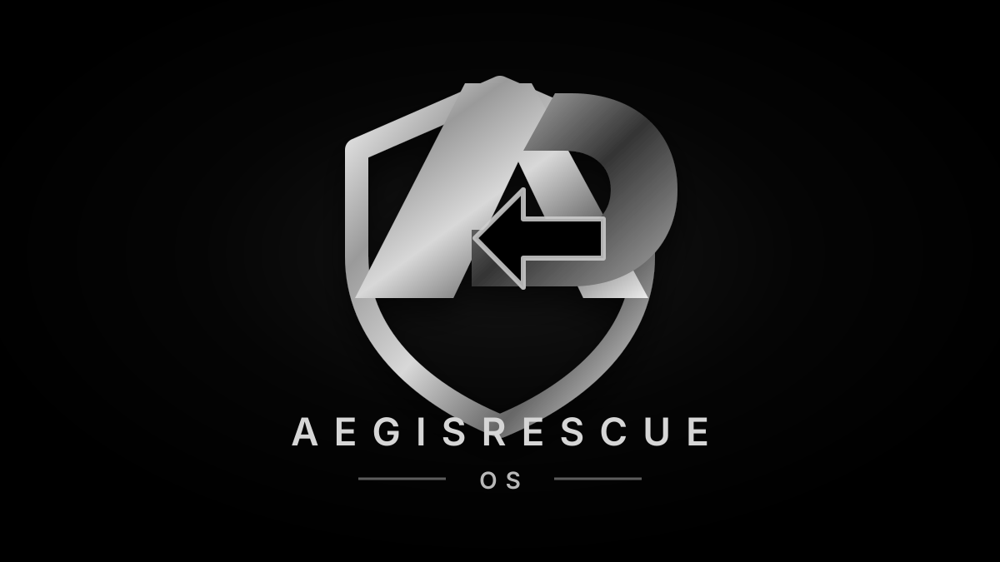

# AegisRescue Linux

<p align="center">
  
</p>

> 악성코드 감염 시스템 복구 및 디지털 포렌식 전용 Live Linux 운영체제

[](LICENSE)
[](https://www.rust-lang.org)
[]()

---

## 개요

AegisRescue는 Ubuntu의 사용성, Kali Linux의 보안 도구 생태계,
SystemRescue의 복구 능력, Clonezilla의 디스크 이미징 기능을 결합한
**Rust 우선(Rust-first) 보안 복구 전용 Live OS**입니다.

### 핵심 기능

| 기능 | 설명 |
|------|------|
| 멀티엔진 악성코드 탐지 | ClamAV + YARA + 휴리스틱 + AI 분류 |
| 랜섬웨어 복구 | 알려진 복호화기 + VSS + 파일 카빙 |
| 안전 마운트 | 감염 디스크 RO+noexec 강제 마운트 |
| 부트 복구 | MBR/GPT/EFI/BCD/GRUB 복원 |
| 디지털 포렌식 | 해시 체인, 타임라인, 아티팩트 수집 |
| 디스크 이미징 | 손상 복사(ddrescue) + 압축 이미지 |
| AI 분석 | 오프라인 정적 분류기 (ONNX/tract) |
| 네트워크 격리 | Air-Gap 모드 기본값 |

### 최소 사양

- RAM: 2GB (4GB 권장)
- CPU: x86_64 또는 ARM64 (aarch64), 듀얼코어 이상
- USB: 4GB 이상 (8GB 권장, toram 모드 시 8GB+)

---

## 빌드 요구사항

```bash
# Rust 툴체인
curl --proto '=https' --tlsv1.2 -sSf https://sh.rustup.rs | sh
rustup target add x86_64-unknown-linux-musl
rustup target add aarch64-unknown-linux-musl

# 시스템 패키지 (Debian/Ubuntu 빌드 호스트)
sudo apt install -y \
    build-essential gcc-aarch64-linux-gnu \
    squashfs-tools mksquashfs \
    grub-pc-bin grub-efi-amd64-bin \
    xorriso dosfstools \
    libssl-dev pkg-config

# Node.js (GUI 빌드용)
curl -fsSL https://deb.nodesource.com/setup_20.x | sudo -E bash -
sudo apt install -y nodejs
```

## 빠른 빌드

```bash
# 1) Rust 코어 빌드
cargo build --release --workspace

# 2) GUI 빌드 (Tauri)
cd gui && npm install && cargo tauri build

# 3) Live ISO 생성
make -C build iso ARCH=x86_64

# 4) USB에 기록
sudo dd if=build/out/aegisrescue-x86_64.iso of=/dev/sdX \
    bs=4M status=progress oflag=sync
```

---

## Windows(WSL2)에서 ISO 빌드 — 매번 할 일

**상세 가이드:** [docs/WSL-BUILD.md](docs/WSL-BUILD.md)

빌드는 Windows 경로(`F:\...`)가 아니라 **`/root/aegisrescue`** 에서 실행합니다.  
소스를 수정·`git pull` 한 뒤에는 반드시 `--copy`로 WSL 홈에 동기화하세요.

### 1) 소스 동기화 (코드 변경 후 필수)

```bash
sudo DEBIAN_FRONTEND=noninteractive TZ=Etc/UTC \
  bash /mnt/f/ofntkd/aegisrescue/build/wsl-build.sh --copy
```

### 2) 전체 빌드 (처음 또는 chroot 초기화 후)

```bash
sudo DEBIAN_FRONTEND=noninteractive TZ=Etc/UTC \
  bash /root/aegisrescue/build/wsl-build.sh
```

### 3) 재빌드 (자주 쓰는 조합)

```bash
# Rust만 변경
sudo bash /root/aegisrescue/build/wsl-build.sh --skip-base --skip-gui

# GUI만 변경 (Tauri)
sudo bash /root/aegisrescue/build/wsl-build.sh --skip-base --skip-rust

# tools/chroot 준비됐을 때 ISO만
sudo bash /root/aegisrescue/build/wsl-build.sh --skip-base --skip-rust --skip-gui
```

### 4) Ubuntu 24.04 — Tauri GUI (최초 1회)

WebKitGTK 4.0이 없어 링크 오류가 나면:

```bash
sudo apt-get install -y libwebkit2gtk-4.1-dev libjavascriptcoregtk-4.1-dev
sudo ln -sf libwebkit2gtk-4.1.so.0        /usr/lib/x86_64-linux-gnu/libwebkit2gtk-4.0.so.0
sudo ln -sf libwebkit2gtk-4.1.so          /usr/lib/x86_64-linux-gnu/libwebkit2gtk-4.0.so
sudo ln -sf libjavascriptcoregtk-4.1.so.0 /usr/lib/x86_64-linux-gnu/libjavascriptcoregtk-4.0.so.0
sudo ln -sf libjavascriptcoregtk-4.1.so   /usr/lib/x86_64-linux-gnu/libjavascriptcoregtk-4.0.so
```

(`wsl-build.sh`가 자동 설치·별칭을 시도합니다.)

### 5) GUI 바이너리 — `build/tools`에 없을 때

Tauri v1은 실행 파일을 `target/release/`가 아니라 **`.deb` 번들**에 넣는 경우가 많습니다.

```bash
sudo dpkg-deb -x /root/aegisrescue/gui/src-tauri/target/release/bundle/deb/aegis-center_0.1.0_amd64.deb /tmp/aegis-gui
sudo cp /tmp/aegis-gui/usr/bin/aegis-center /root/aegisrescue/build/tools/aegiscenter

sudo dpkg-deb -x /root/aegisrescue/installer/src-tauri/target/release/bundle/deb/aegis-rescue-installer_0.1.0_amd64.deb /tmp/aegis-inst
sudo cp /tmp/aegis-inst/usr/bin/aegis-rescue-installer /root/aegisrescue/build/tools/aegis-installer
```

또는: `sudo python3 /root/aegisrescue/build/gen-tauri-icons.py --root /root/aegisrescue` (아이콘) 후 GUI 빌드 재실행.

### 6) chroot 수동 복사 (주의: glob)

`sudo cp /root/.../tools/*` 는 **일반 사용자 셸이 glob을 펼치기 때문에** 실패할 수 있습니다.

```bash
sudo bash -c 'cp -a /root/aegisrescue/build/tools/. /root/aegisrescue/build/chroot/opt/aegis/bin/'
```

### 7) 성공 확인

```bash
sudo ls -lh /root/aegisrescue/build/tools/aegiscenter /root/aegisrescue/build/tools/aegis-installer
sudo ls -lh /root/aegisrescue/build/chroot/opt/aegis/bin/aegiscenter
sudo ls -lh /root/aegisrescue/build/out/*.iso
sudo tail -30 /root/aegisrescue/build/out/gui-build.log   # GUI 문제 시
```

---

## 프로젝트 구조

```
aegisrescue/
├── core/               # Rust 워크스페이스 (모든 핵심 도구)
│   ├── aegis-common/   # 공용 라이브러리
│   ├── aegisd/         # 시스템 데몬
│   ├── aegis-mount/    # 안전 마운트 관리자
│   ├── aegis-scan/     # 악성코드 탐지 엔진
│   ├── aegis-recover/  # 랜섬웨어/파일 복구
│   ├── aegis-boot/     # 부트 레코드 복구
│   ├── aegis-forensic/ # 디지털 포렌식
│   ├── aegis-image/    # 디스크 이미징/클론
│   ├── aegis-ai/       # AI 악성코드 분류
│   ├── aegis-sandbox/  # 샌드박스 런처
│   └── aegis-cli/      # 통합 CLI
├── gui/                # AegisCenter (Tauri + Svelte)
├── kernel/             # 커널 설정/패치
├── security/           # AppArmor, seccomp, nftables
├── data/               # YARA룰, 시그니처, AI 모델
├── build/              # ISO 빌드 스크립트
├── packaging/          # .deb 패키징
├── docs/               # 설계/개발 문서
└── tests/              # 통합 테스트
```

---

## 라이선스

- 코어 OS 및 도구: **GPLv3**
- Rust 라이브러리 컴포넌트: **Apache-2.0 OR MIT**

## 기여

[CONTRIBUTING.md](docs/CONTRIBUTING.md) 참조
